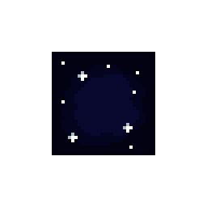
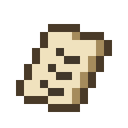

# Registro visual

Muestra el arte que **ya existe** y de dónde viene cada pieza. Las decisiones de estilo están en [[01 - Dirección de Arte]]; aquí solo se registra lo hecho.

> [!info] Procedencia y límites
> - Las imágenes se copiaron el 08/11/2026 desde el repositorio del juego (`Assets/Astrolabio/Art/`) y desde la carpeta de assets del equipo.
> - Son **archivos de arte**, no capturas de pantalla del juego. Todavía no hay capturas ni GIF de partida en el GDD.
> - Las hojas de 32 px se muestran ampliadas; Obsidian puede suavizarlas. El archivo original conserva los píxeles exactos.
> - Paleta base: SLSO8.

## Logotipo

Archivo: `Media/Logo-Astrolabio.png` (4989 × 564 px).

## Personaje: el Almanaque XII

Siete hojas de fotogramas de 32 × 32 px. El juego las usa en 13 clips de animación con Animator. Archivos fuente: `Art/Characters/Almanaque/almanaque_*.png`. Detalle de diseño en [[02 - Personajes y Animación]].

| Hoja | Fotogramas | Imagen |
| --- | --- | --- |
| Reposo | 7 |  |
| Correr | 7 |  |
| Salto | 7 |  |
| Pared | 3 |  |
| Escalar | 4 |  |
| Gancho | 3 |  |
| Muerte | 6 |  |

## Entorno

Tiles de 32 × 32 px (1 tile = 1 unidad) construidos como *Rule Tiles*. Detalle en [[03 - Entornos]].

| Pieza | Descripción | Imagen |
| --- | --- | --- |
| Tileset del tutorial | Piedra dorada y piedra azul oscura, con bordes y esquinas (256 × 256 px) |  |
| Pared escalable | Piedra rugosa que el Almanaque puede agarrar |  |
| Engranaje y pinchos | Peligros letales pintados con tiles |  |
| Gas nebuloso (v3) | Peligro que mata y corta el gancho |  |
| Plataforma estelar (v2) | Metal estelar que responde al gancho |  |
| Plataforma estelar (animación) | La misma pieza en movimiento |  |

## Piezas de nivel

| Pieza | Función en el juego | Imagen |
| --- | --- | --- |
| Farol | Punto de enganche para el gancho |  |
| Estrella ancla | La estrella que el jugador escribe en el vacío |  |
| Estrella recargable | Recarga los usos del gancho |  |
| Checkpoint apagado | Punto de reaparición sin activar |  |
| Checkpoint encendido | Punto de reaparición activo |  |
| Nicho | Decorado de la Sala de los Nichos |  |
| Compuerta | Animación de apertura |  |
| Cadenas | Decorado del Pozo de Cadenas |  |
| Notas coleccionables | Hoja de arte (sin integrar como objeto recogible) |  |
| Notas coleccionables (animación) | La misma pieza en movimiento |  |

## Qué falta en este registro

- Capturas de partida de cada zona (Entrañas, Pozo Celeste y Eje Central).
- GIF de las mecánicas (gancho, escalada, elevador).
- Interfaz: el HUD, los menús y la caja de diálogo siguen la dirección visual de [[04 - Interfaz Visual]], pero no hay captura todavía.
- Arte de Efeméride (sprites dibujados, sin integrar) y del Eje Central.

Cuando existan, se agregan aquí con fecha, escena y versión del juego.

> **Navegación:** [[00 - Índice]] · ← [[05 - Audio y Música]] · [[01 - UX y Flujo del Jugador]] →
